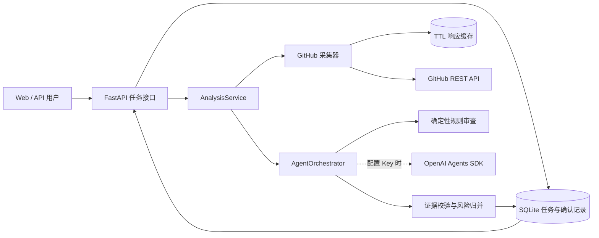

# 系统架构

## 边界设计

- 采集层只负责公开仓库事实，不接受模型生成的数据。
- 规则层提供无模型也可运行的稳定基线。
- 模型层只解释已提供的证据 ID；失败、超时或结构非法时按章节降级。
- 证据校验是最终报告前的质量闸门，无证据的高风险结论必须转为待确认。
- API 任务状态与报告持久化，进程重启不会把遗留任务伪装成成功。

## 关键状态流转

`queued → collecting → reviewing → verifying → awaiting_confirmation → completed`

任一执行阶段均可进入 `failed`，并保存稳定错误码、用户消息和是否可重试标记。
